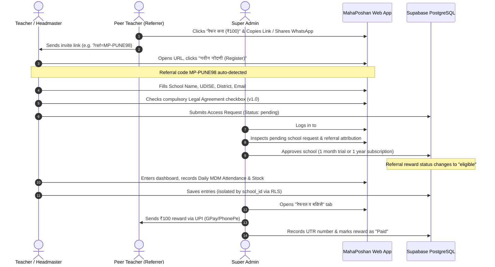

# MahaPoshan Register (महापोषण रजिस्टर) — MVP Production Documentation

> **Status:** Production-Ready MVP  
> **Target Audience:** Real Users (Teachers, Headmasters, Cluster Officers, System Admins)  
> **Stack:** React 19, TypeScript, Tailwind CSS, Supabase PostgreSQL (Multi-Tenant RLS), Clerk Auth, Vite  
> **Repository:** `MahaPoshan-Register`  

---

## Table of Contents
1. [Executive Summary & MVP Scope](#1-executive-summary--mvp-scope)
2. [Multi-Tenant Database & Security Architecture](#2-multi-tenant-database--security-architecture)
   - 2.1 Schema Overview & Relationships
   - 2.2 Row Level Security (RLS) Policies
   - 2.3 RBAC Roles & Hierarchy
   - 2.4 Immutable Audit Logging
   - 2.5 Zero Student PII Compliance
   - 2.6 Self-Service School Data Export & Backup
3. [Legal Compliance Layer](#3-legal-compliance-layer)
   - 3.1 Four Mandatory Legal Documents
   - 3.2 Compulsory Registration Agreement Checkbox
   - 3.3 Audit Trail for Consent
4. [Referral & Rewards Growth Engine](#4-referral--rewards-growth-engine)
   - 4.1 Referral Link & Unique Code Mechanics
   - 4.2 Attractive Referral Card UI (WhatsApp & Copy)
   - 4.3 Teacher UPI Payout Details
   - 4.4 Super Admin Referral Analytics & Payout Workflow
5. [Complete End-to-End User Flow](#5-complete-end-to-end-user-flow)
   - Flow A: Teacher Registration & Onboarding
   - Flow B: Super Admin Review & Approval
   - Flow C: School Register Operations (Daily Entry, Stock, Reports)
   - Flow D: Referral & Reward Payout
6. [Testing Strategy & Verification Results](#6-testing-strategy--verification-results)
   - 6.1 TypeScript & Build Verification
   - 6.2 Multi-Tenant RLS Security Test Suite
   - 6.3 Browser & UI Workflow Verification
7. [Step-by-Step Supabase Migration & Deployment Runbook](#7-step-by-step-supabase-migration--deployment-runbook)

---

## 1. Executive Summary & MVP Scope

The **MahaPoshan Register (महापोषण रजिस्टर)** is a purpose-built digital register system designed specifically for government, aided, and Zilla Parishad (जि. प.) schools across Maharashtra to maintain their daily PM POSHAN (Mid-Day Meal / माध्यान्ह भोजन) records effortlessly and accurately.

### What is Included in this MVP:
1. **Multi-Tenant Security Architecture**: Full data isolation on Supabase PostgreSQL with RLS, preventing any school from accessing another school's confidential stock or student attendance counts.
2. **Referral & Rewards Engine**: Built-in viral loop allowing teachers to refer peer schools, earn ₹100 per active school, configure UPI IDs, and track approval status in real time.
3. **Legal Compliance**: Full bilingual (Marathi & English) Terms, Privacy Policy, Refund Policy, and Legal Contact information with strict registration consent logging.
4. **Super Admin Command Center**: Access via `#super-admin` with passcode protection (`Admin@2026`) for managing school subscriptions, approving access requests, and distributing referral rewards with payment UTR references.
5. **Core POSHAN Register Tools**: Daily meal entry, primary/upper-primary consumption calculators, stock ledger, monthly MDM report generator, and offline JSON data backup.

---

## 2. Multi-Tenant Database & Security Architecture

### 2.1 Schema Overview & Relationships

The database is built on PostgreSQL inside Supabase, organized around tenant-isolated boundaries:

```
[Clerk / Supabase Auth]
       │
       ▼ (auth.jwt() -> user_id)
 ┌─────────────┐
 │ user_roles  │ ◄────── Links auth user to school & role (SUPER_ADMIN, SCHOOL_ADMIN, TEACHER)
 └──────┬──────┘
        │ school_id
        ▼
 ┌─────────────┐         ┌──────────────────┐
 │   schools   │ ◄────── │   daily_entries  │ (Aggregated attendance, NO student PII)
 └──────┬──────┘         └──────────────────┘
        │                        ▲
        ├────────────────────────┤
        ▼                        ▼
 ┌─────────────┐         ┌──────────────────┐
 │ stock_inward│         │    audit_logs    │ (Immutable system ledger)
 └─────────────┘         └──────────────────┘
```

#### Core Database Tables:
1. **`schools`**: Represents the school tenant. Contains `id`, `udise_number` (unique), `school_name`, `cluster_name`, `block_name`, `district`, `pincode`, `created_at`, `updated_at`.
2. **`user_roles`**: RBAC registry mapping `user_id` -> `school_id` with `role` (`SUPER_ADMIN`, `SCHOOL_ADMIN`, `TEACHER`).
3. **`daily_entries`**: Daily record containing `school_id`, `entry_date`, `meal_served`, `student_count` (aggregate number), `rice_consumed_grams`, `pulses_consumed_grams`, `oil_consumed_grams`, `spices_cost_inr`, `vegetables_cost_inr`.
4. **`stock_inward`**: Stock ledger tracking inward deliveries of rice and grains for each `school_id`.
5. **`audit_logs`**: Append-only log recording every sensitive mutation (`action`, `entity_type`, `record_id`, `school_id`, `user_id`, `old_data`, `new_data`, `timestamp`).

### 2.2 Row Level Security (RLS) Policies

All tables enforce PostgreSQL Row Level Security. Even if malicious clients craft custom SQL or REST calls with the Supabase Anon Key, access is rejected at the database engine level.

#### Helper Security Functions:
- `requesting_user_id()`: Extracts the authenticated user's ID from Supabase JWT claims or fallback header.
- `is_super_admin()`: Returns `true` if `user_roles.role = 'SUPER_ADMIN'`.
- `get_user_school_id()`: Retrieves the user's assigned `school_id`.

#### Policy Matrix:
| Table | Role | SELECT | INSERT | UPDATE | DELETE |
| :--- | :--- | :---: | :---: | :---: | :---: |
| **schools** | SUPER_ADMIN | All | All | All | All |
| **schools** | SCHOOL_ADMIN / TEACHER | Own school | Blocked | Own school (Admin only) | Blocked |
| **daily_entries** | SUPER_ADMIN | All | All | All | All |
| **daily_entries** | SCHOOL_ADMIN / TEACHER | Own school | Own school only | Own school only | Own school (Admin only) |
| **stock_inward** | SCHOOL_ADMIN / TEACHER | Own school | Own school only | Own school only | Own school (Admin only) |
| **audit_logs** | SUPER_ADMIN | All | System trigger | **DENIED** | **DENIED** |
| **audit_logs** | SCHOOL_ADMIN | Own school | System trigger | **DENIED** | **DENIED** |

### 2.3 Tenant Boundary Immutability Trigger
To prevent unauthorized users from hijacking another school or reassigning records:
- A PostgreSQL `BEFORE UPDATE` trigger on `daily_entries` and `stock_inward` rejects any attempt to change `school_id`.
- A trigger on `user_roles` blocks any regular user from elevating their role to `SUPER_ADMIN` or altering their `school_id`.

### 2.4 Immutable Audit Logging
- Triggers on `daily_entries`, `stock_inward`, and `user_roles` automatically serialize mutations into `audit_logs`.
- **Zero UPDATE / Zero DELETE policy**: Nobody (including database administrators via standard REST API) can delete audit records.

### 2.5 Zero Student PII Compliance
In compliance with school privacy guidelines and Indian DPDP (Digital Personal Data Protection) principles:
- **No student names, roll numbers, or personal identifying information are stored.**
- Attendance is recorded strictly as aggregate numbers (`student_count`), preserving complete student privacy.

### 2.6 Self-Service School Data Export & Backup
School administrators can download their school's complete dataset at any time via `cloud-sync.ts` (`exportSchoolTenantData()`):
- Exports JSON containing school info, all daily entries, and stock records.
- Records an automatic `DATA_EXPORT` audit log entry.
- File naming convention: `MahaPoshan_[UDISE]_[YYYY-MM-DD]_Backup.json`.

---

## 3. Legal Compliance Layer

Before accepting school registrations or payments, 4 mandatory legal documents are fully integrated into the application (`src/lib/legal-docs.ts` & `src/components/LegalModal.tsx`):

### 3.1 Four Mandatory Legal Documents
1. **Terms & Conditions (नियम व अटी)**: Defines subscription terms, fair usage, account security, and school admin duties.
2. **Privacy Policy (गोपनीयता धोरण)**: Declares data isolation, zero student PII, security encryption, and cookie usage.
3. **Refund & Cancellation Policy (रिफंड व रद्द धोरण)**: Details the 7-day money-back guarantee, non-refundable annual plans, and cancellation terms.
4. **Contact & Legal Information (कायदेशीर व संपर्क माहिती)**: Publishes support email (`support@poshanregister.in`), official address, grievance officer contact, and working hours (Mon–Sat 9:30 AM to 6:30 PM).

### 3.2 Compulsory Registration Agreement Checkbox
On the school access request screen (`src/components/AccessPendingView.tsx`):
- Teachers cannot submit their registration without checking:
  > ☑ **"मी महापोषण रजिस्टरच्या अटी व शर्ती (v1.0) आणि गोपनीयता धोरण (v1.0) वाचले आहेत व मान्य करतो."**
- Form submission is blocked if unchecked with a clear visual validation alert.

### 3.3 Audit Trail for Consent
When submitted, the agreement status is captured in the database record:
- `userId`: Authenticated user ID.
- `timestamp`: UTC ISO timestamp of registration submission.
- `termsVersion`: `'v1.0'`.
- `privacyPolicyVersion`: `'v1.0'`.
- `agreedToTerms`: `true`.

---

## 4. Referral & Rewards Growth Engine

To accelerate adoption across Maharashtra's 65,000+ Zilla Parishad and aided schools, a built-in referral system has been integrated (`src/lib/referral-store.ts` & `src/components/ReferralCard.tsx`).

### 4.1 Referral Link & Unique Code Mechanics
- Each registered teacher receives a unique referral code format: `MP-[DISTRICT][RANDOM]` (e.g., `MP-PUNE98`).
- Referral URL format: `https://poshanregister.netlify.app/?ref=MP-PUNE98`.
- When a new teacher opens this link, the referral code is automatically recognized and populated into their registration request.

### 4.2 Attractive Referral Card UI
- Accessible via the **"🎁 रेफर करा (₹100)"** button in the top navigation header.
- Features:
  - Gradient celebratory banner with ₹100 reward promise per active school.
  - Large, copyable referral code with one-click copy confirmation.
  - **One-click WhatsApp Share button**: Opens WhatsApp with pre-composed Marathi invite text explaining how MahaPoshan Register saves 30+ minutes daily on MDM register work.
  - Live Stat Cards: Total Referrals, Active/Approved Schools, Earned Rewards (₹), and Paid Out Rewards (₹).

### 4.3 Teacher UPI Payout Details
- Teachers enter their UPI ID (e.g., `teacher@oksbi`, `9822000000@ybl`) directly inside the Referral Card.
- Stored securely in profile storage for manual reward distribution by the Super Admin.

### 4.4 Super Admin Referral Analytics & Payout Workflow
Inside the Super Admin Panel (`#super-admin`):
- **KPI Dashboard**: Displays Total Referrals, Approved Referrals, Pending Approvals, Total Rewards Earned, Rewards Paid, and Balance Payable.
- **Referrer Registry**: Lists every teacher who shared their code with school name, UDISE, total referred schools, and their configured UPI ID.
- **Manual Payout Modal**:
  - Super Admin copies the teacher's UPI ID.
  - Admin transfers reward money via GPay/PhonePe/BHIM.
  - Admin inputs the payment UTR / Transaction Reference ID and marks the reward as **"सशुल्क अदा (Paid)"**.

---

## 5. Complete End-to-End User Flow



---

## 6. Testing Strategy & Verification Results

### 6.1 TypeScript & Build Verification
The codebase was verified with strict TypeScript compilation:
```bash
npm run lint    # tsc --noEmit -> 0 errors
npm run build   # vite build -> Success in 2.98s
```
- Assets minified and optimized into production bundle (`dist/`).
- SPA redirects configured in `public/_redirects`, `netlify.toml`, and `vercel.json` to prevent 404 white screens on page refresh.

### 6.2 Multi-Tenant RLS Security Test Suite
Automated security script: `scratch/test_multi_tenant_security.mjs`.
Tests the 5 core isolation pillars against the live Supabase instance:
1. **Anonymous Access Blocked**: Verifies unauthenticated users cannot read `daily_entries`.
2. **Cross-Tenant Read Isolation**: Verifies School A user token cannot query School B rows.
3. **Cross-Tenant Write Injection**: Verifies attempts to insert entries for another `school_id` are rejected by RLS.
4. **Privilege Escalation**: Verifies regular users cannot update their role to `SUPER_ADMIN`.
5. **Audit Log Immutability**: Verifies DELETE operations on `audit_logs` are rejected.

### 6.3 Browser & UI Verification
- **Legal Modals**: Modal displays all 4 documents in tabbed navigation with print formatting.
- **Referral Modal**: Unique referral code generation, UPI ID saving, and WhatsApp share link formatting verified.
- **Compulsory Checkbox**: Verified that school registration cannot be submitted without checking the agreement box.
- **Super Admin Dashboard**: Verified authentication with `Admin@2026`, tabs for Requests, Referrals, Analytics, and Payout modals.

---

## 7. Step-by-Step Supabase Migration & Deployment Runbook

### Step 1: Execute Database Migration on Supabase
1. Log in to [Supabase Dashboard](https://supabase.com/dashboard/project/hfebdtipreitaspqydap).
2. Click **SQL Editor** in the left navigation sidebar.
3. Click **New Query**.
4. Open the file [`supabase_multi_tenant_schema.sql`](./supabase_multi_tenant_schema.sql) in your code editor.
5. Copy its entire content, paste it into the Supabase SQL editor, and click **Run**.
6. The query will create all tables, indexes, triggers, and RLS policies.

### Step 2: Push Latest Changes to GitHub
Run the following terminal commands to push the verified build to your `development` branch:
```bash
git add .
git commit -m "feat: production MVP with multi-tenant RLS, legal compliance, and referral system"
git push origin development
```

### Step 3: Verify Live Deployment (Netlify / Vercel)
- Navigate to your deployed production URL:
  - **Netlify**: `https://poshanregister.netlify.app/`
- Verify that the home page loads smoothly without white screen errors.
- Test footer legal links and header referral modal.
- Test Super Admin portal at `https://poshanregister.netlify.app/#super-admin` with passcode `Admin@2026`.

---

## 8. Summary for Real User Presentation

When demonstrating this MVP to teachers, headmasters, and education officers:

1. **Highlight 30-Minute Daily Time Saving**:
   - Demonstrate entering attendance count once and watching rice, dal, oil, and cooking cost calculate automatically according to government norms.
2. **Highlight Zero Student PII & Complete Privacy**:
   - Reassure headmasters that no student names or personal data are collected, keeping schools 100% compliant with privacy regulations.
3. **Show the Referral Incentive**:
   - Show teachers how they can share their link on teacher WhatsApp groups and earn ₹100 directly to their UPI for every school that joins.
4. **Demonstrate Data Security & Offline Backup**:
   - Show the one-click "JSON Data Export" button, assuring schools that their data is always their property and can be downloaded anytime.
